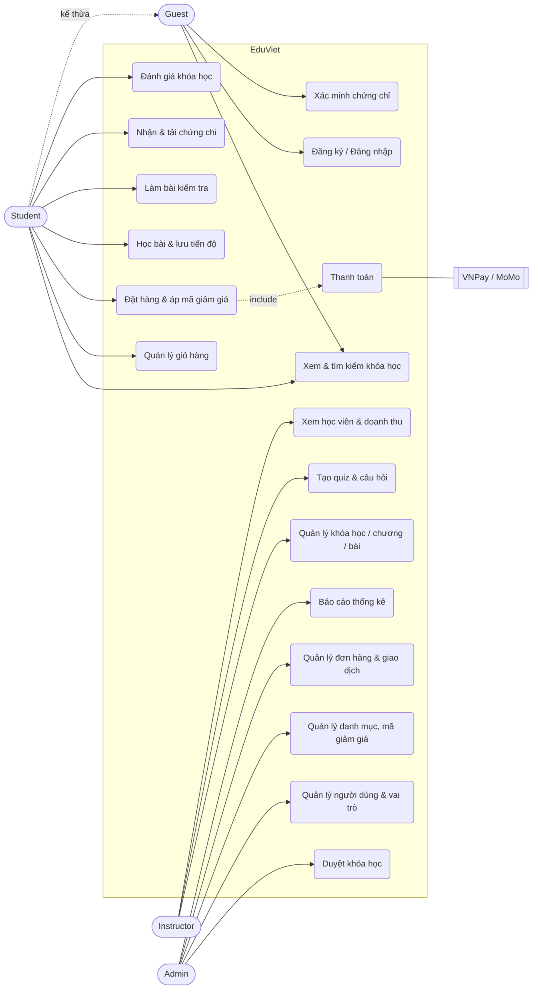
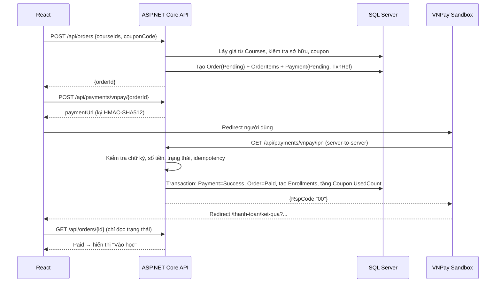
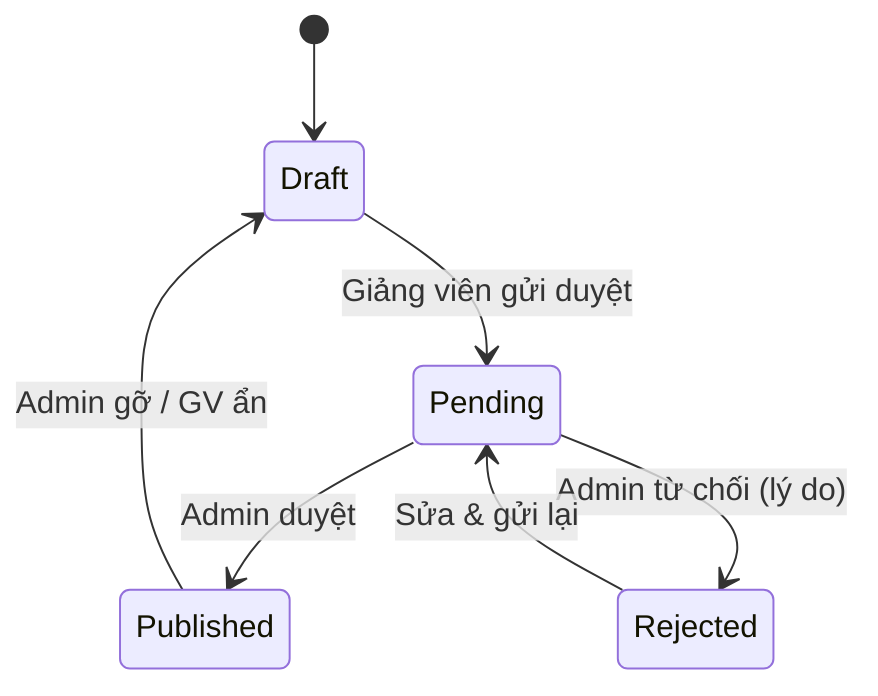
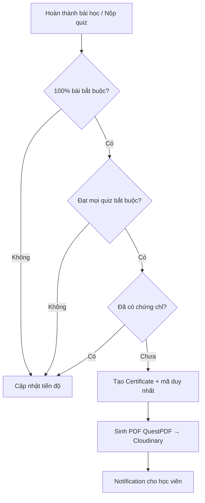

# 01 — Phân tích yêu cầu & đặc tả nghiệp vụ

Tên sản phẩm (tạm): **EduViet** — nền tảng bán và học khóa học trực tuyến.

## 1. Mục tiêu

| Mục tiêu | Thước đo |
| --- | --- |
| Học viên tìm, mua và học khóa học trên mọi thiết bị | Mua được khóa học trong ≤ 3 bước từ trang chi tiết |
| Giảng viên tự xuất bản khóa học, có Admin kiểm duyệt | Quy trình Draft → Pending → Published/Rejected |
| Thanh toán an toàn, đối soát được | Quyền học chỉ cấp khi Backend xác thực chữ ký IPN |
| Chứng chỉ có thể xác minh công khai | Mỗi chứng chỉ có mã duy nhất, trang `/xac-minh/{code}` |

## 2. Tác nhân (Actors)

| Vai trò | Mô tả | Quyền chính |
| --- | --- | --- |
| **Guest** | Khách chưa đăng nhập | Xem trang chủ, tìm kiếm, xem chi tiết khóa học, xem bài học preview, xác minh chứng chỉ, đăng ký, đăng nhập |
| **Student** | Học viên đã đăng ký | Giỏ hàng, đặt hàng, thanh toán, học, làm bài kiểm tra, nhận chứng chỉ, đánh giá khóa học đã mua |
| **Instructor** | Giảng viên (Admin cấp quyền hoặc duyệt đơn đăng ký giảng viên) | CRUD khóa học của mình, chương/bài học, tài liệu, quiz, xem học viên/doanh thu, trả lời đánh giá |
| **Admin** | Quản trị hệ thống | Toàn quyền: người dùng, danh mục, duyệt khóa học, đơn hàng, giao dịch, mã giảm giá, chứng chỉ, báo cáo |

Một tài khoản có thể có nhiều vai trò (ví dụ Instructor cũng là Student). Tài khoản mới đăng ký luôn mang vai trò `Student`.

## 3. Danh sách chức năng (Functional Requirements)

Mã chức năng dùng xuyên suốt tài liệu, API và kiểm thử.

### 3.1 Trang chủ & khám phá (FR-HOME)
- FR-HOME-01 Banner giới thiệu, ô tìm kiếm.
- FR-HOME-02 Khóa học nổi bật (`IsFeatured`), mới nhất (`PublishedAt` desc), bán chạy (`EnrollmentCount` desc).
- FR-HOME-03 Danh mục khóa học (cây 2 cấp).
- FR-HOME-04 Giảng viên nổi bật (theo tổng học viên + điểm đánh giá).
- FR-HOME-05 Đánh giá tiêu biểu của học viên (rating ≥ 4, có nội dung).
- FR-HOME-06 Tìm kiếm + lọc: từ khóa, danh mục, cấp độ, khoảng giá, rating; sắp xếp; phân trang.

### 3.2 Tài khoản (FR-AUTH)
- FR-AUTH-01 Đăng ký (họ tên, email, mật khẩu) → vai trò Student, gửi email xác nhận.
- FR-AUTH-02 Đăng nhập trả về Access Token (JWT, 15 phút) + Refresh Token (7 ngày, HttpOnly cookie).
- FR-AUTH-03 Refresh token xoay vòng (rotation); phát hiện token cũ bị dùng lại → thu hồi toàn chuỗi.
- FR-AUTH-04 Đăng xuất = thu hồi refresh token.
- FR-AUTH-05 Quên mật khẩu → email chứa link đặt lại (token Identity, hết hạn 1 giờ).
- FR-AUTH-06 Cập nhật hồ sơ, ảnh đại diện; đổi mật khẩu (thu hồi mọi refresh token khác).
- FR-AUTH-07 Admin gán/bỏ vai trò, khóa/mở khóa tài khoản.

### 3.3 Khóa học (FR-COURSE)
- FR-COURSE-01 Instructor tạo/sửa/xóa mềm khóa học của mình (chỉ khi Draft hoặc Rejected được sửa nội dung chính).
- FR-COURSE-02 Ảnh đại diện, video giới thiệu (Cloudinary).
- FR-COURSE-03 Thuộc tính: danh mục, giá, giá khuyến mãi, cấp độ (Beginner/Intermediate/Advanced), mô tả, yêu cầu, kết quả đạt được.
- FR-COURSE-04 Chương (Section) và bài học (Lesson) có thứ tự, kéo thả sắp xếp.
- FR-COURSE-05 Bài học: video, bài viết; tài liệu đính kèm (PDF, ZIP…); cờ `IsPreview`, `IsRequired`.
- FR-COURSE-06 Trạng thái: `Draft → Pending` (gửi duyệt) → `Published` | `Rejected` (kèm lý do) → có thể sửa và gửi lại. Admin có thể `Unpublish` về `Draft`.
- FR-COURSE-07 Admin CRUD danh mục.

### 3.4 Mua khóa học (FR-ORDER)
- FR-ORDER-01 Xem chi tiết khóa học (đề cương, giảng viên, đánh giá).
- FR-ORDER-02 Giỏ hàng (thêm/xóa). Không thêm khóa đã sở hữu hoặc khóa của chính mình.
- FR-ORDER-03 Tạo đơn hàng từ giỏ hoặc "Mua ngay". **Giá lấy từ DB**, Frontend chỉ gửi danh sách `courseId` + mã giảm giá.
- FR-ORDER-04 Áp mã giảm giá (kiểm tra hiệu lực, giới hạn lượt, giá trị tối thiểu, phạm vi khóa học).
- FR-ORDER-05 Thanh toán VNPay Sandbox (chính) / MoMo Sandbox (phụ).
- FR-ORDER-06 Nhận IPN từ cổng → xác thực chữ ký + số tiền + trạng thái → idempotent → đơn `Paid` → tạo Enrollment.
- FR-ORDER-07 Trang Return chỉ **hiển thị** kết quả bằng cách hỏi Backend trạng thái đơn, không cấp quyền.
- FR-ORDER-08 Đơn tổng 0đ (mã giảm 100%) hoàn tất không qua cổng.
- FR-ORDER-09 Đơn `Pending` quá 30 phút tự hết hạn (`Expired`). Lượt mã giảm giá chỉ bị trừ khi đơn `Paid`, nên đơn hết hạn/hủy không tốn lượt.

### 3.5 Học trực tuyến (FR-LEARN)
- FR-LEARN-01 Trình học: danh sách chương/bài bên cạnh, video, nội dung, tài liệu.
- FR-LEARN-02 Link video/tài liệu trả phí là **signed URL** có hạn, chỉ cấp khi có Enrollment.
- FR-LEARN-03 Đánh dấu hoàn thành; lưu vị trí xem video (`LastPositionSeconds`).
- FR-LEARN-04 "Tiếp tục học" → bài gần nhất (`Enrollment.LastLessonId`).
- FR-LEARN-05 % hoàn thành = bài bắt buộc đã xong / tổng bài bắt buộc.

### 3.6 Kiểm tra (FR-QUIZ)
- FR-QUIZ-01 Instructor tạo quiz gắn với khóa học (tùy chọn gắn chương), đánh dấu bài thi cuối khóa.
- FR-QUIZ-02 Câu hỏi một đáp án / nhiều đáp án / đúng-sai, điểm từng câu.
- FR-QUIZ-03 Điểm đạt (%), số lần làm tối đa, thời gian giới hạn.
- FR-QUIZ-04 Backend chấm điểm; không gửi `IsCorrect` xuống client trước khi nộp.
- FR-QUIZ-05 Lưu lịch sử từng lần làm.

### 3.7 Chứng chỉ (FR-CERT)
- FR-CERT-01 Điều kiện: 100% bài bắt buộc + đạt mọi quiz `IsRequired`.
- FR-CERT-02 Tự cấp khi điều kiện thỏa (sau khi hoàn thành bài/nộp quiz); idempotent (1 chứng chỉ / học viên / khóa).
- FR-CERT-03 Mã định danh dạng `EDV-2026-7F3K9QX2` (unique), PDF sinh bằng QuestPDF có QR tới trang xác minh.
- FR-CERT-04 Trang xác minh công khai; Admin có thể thu hồi.

### 3.8 Dashboard
- Học viên: khóa đã mua, đang học, tiến độ, lịch sử thanh toán, kết quả kiểm tra, chứng chỉ, hồ sơ.
- Giảng viên: khóa học, nội dung, học viên, biểu đồ đăng ký & doanh thu theo tháng, đánh giá.
- Admin: tổng quan (doanh thu, học viên mới, khóa chờ duyệt), quản lý người dùng/khóa/danh mục/đơn/giao dịch/mã giảm giá/chứng chỉ, báo cáo.

## 4. Quy tắc nghiệp vụ (Business Rules)

| Mã | Quy tắc |
| --- | --- |
| BR-01 | Giá bán thực = `DiscountPrice` nếu có và < `Price`, ngược lại `Price`. Tiền tệ VND, làm tròn đến đồng. |
| BR-02 | Không tạo đơn chứa khóa đã sở hữu, khóa chưa Published, hoặc khóa của chính người mua. |
| BR-03 | Mỗi học viên chỉ có 1 Enrollment / khóa (unique index). |
| BR-04 | Giá trong `OrderItems` là ảnh chụp tại thời điểm đặt (không đổi khi giảng viên đổi giá). |
| BR-05 | Coupon: `Percentage` (0–100, có trần `MaxDiscountAmount`) hoặc `FixedAmount`; giảm không vượt tổng đơn. |
| BR-06 | Một giao dịch cổng (`Provider` + `ProviderTransactionId`) chỉ được xử lý một lần. |
| BR-07 | IPN hợp lệ khi: chữ ký đúng, `Amount` = `Order.TotalAmount`, đơn tồn tại và đang `Pending`. |
| BR-08 | Chỉ khóa `Published` hiển thị công khai; khóa bị gỡ vẫn cho học viên đã mua tiếp tục học. |
| BR-09 | Đánh giá: chỉ học viên có Enrollment, 1 đánh giá / khóa, rating 1–5. |
| BR-10 | Quiz: lần làm thứ n bị từ chối nếu n > `MaxAttempts`; điểm tính theo điểm cao nhất. |
| BR-11 | Xóa khóa học là xóa mềm (`IsDeleted`) nếu đã có Enrollment. |
| BR-12 | Doanh thu giảng viên = tổng `OrderItems.FinalPrice` của khóa thuộc giảng viên, đơn `Paid`. |

## 5. Yêu cầu phi chức năng

- **Bảo mật**: Identity (PBKDF2), JWT ký HMAC-SHA256 khóa ≥ 256 bit lấy từ biến môi trường/User Secrets, refresh token lưu **hash SHA-256**, rate limit đăng nhập & IPN, CORS giới hạn origin, HTTPS, header bảo mật, EF Core tham số hóa (chống SQL Injection), React tự escape + sanitize HTML bài viết bằng DOMPurify (chống XSS), FluentValidation cho mọi input.
- **Hiệu năng**: API danh sách có phân trang; index trên cột lọc/sắp xếp; `AsNoTracking` cho truy vấn đọc.
- **Khả dụng**: Responsive 360px → 1920px; giao diện tiếng Việt; trạng thái loading/empty/error.
- **Khả năng bảo trì**: Clean Architecture, DI, logging Serilog, Swagger.

## 6. Use Case Diagram

## 7. Luồng nghiệp vụ quan trọng

### 7.1 Thanh toán VNPay (cấp quyền chỉ qua IPN)

### 7.2 Vòng đời khóa học

### 7.3 Cấp chứng chỉ

