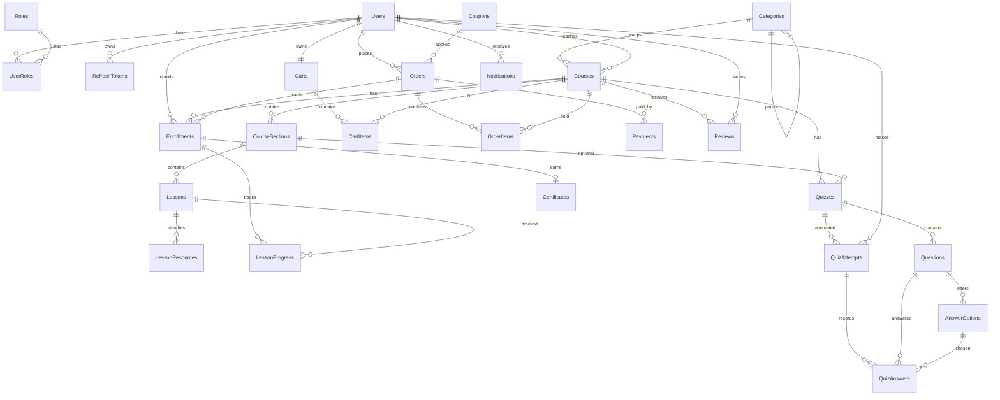

# 03 — Thiết kế cơ sở dữ liệu (SQL Server)

- Code First bằng EF Core; script tham chiếu tương đương ở [`database/schema.sql`](../database/schema.sql).
- Khóa chính `uniqueidentifier` (`NEWSEQUENTIALID()`) — không đoán được ID, không phân mảnh index.
- Tiền: `decimal(18,2)` (VND). Thời gian: `datetime2` UTC.
- Enum lưu dạng `nvarchar` (dễ đọc khi đối soát, không vỡ khi đổi thứ tự enum).
- Bảng Identity: `Users`, `Roles`, `UserRoles`, `UserClaims`, `UserLogins`, `UserTokens`, `RoleClaims` (đổi tên từ `AspNet*`).
- Xóa: cascade **chỉ trong cùng aggregate** (Course→Section→Lesson→Resource, Order→Item, Quiz→Question→Option…), còn lại `NO ACTION` để tránh multiple cascade paths của SQL Server.

## 1. ERD

## 2. Từ điển dữ liệu

Ký hiệu: **PK** khóa chính, **FK** khóa ngoại, **UQ** unique, **IX** index, **CK** check.

### Users (ASP.NET Identity + mở rộng)
| Cột | Kiểu | Ràng buộc |
| --- | --- | --- |
| Id | uniqueidentifier | PK |
| UserName, NormalizedUserName | nvarchar(256) | UQ NormalizedUserName |
| Email, NormalizedEmail | nvarchar(256) | IX NormalizedEmail |
| PasswordHash, SecurityStamp, ConcurrencyStamp, PhoneNumber… | (Identity) | |
| FullName | nvarchar(150) | NOT NULL |
| AvatarUrl | nvarchar(500) | |
| Headline | nvarchar(200) | Chức danh giảng viên |
| Bio | nvarchar(max) | |
| IsActive | bit | DEFAULT 1 |
| CreatedAt, UpdatedAt | datetime2 | |

### Roles / UserRoles
`Roles(Id PK, Name, NormalizedName UQ, Description)`; `UserRoles(UserId FK, RoleId FK, PK(UserId, RoleId))`. Dữ liệu: `Admin`, `Instructor`, `Student`.

### RefreshTokens
| Cột | Kiểu | Ràng buộc |
| --- | --- | --- |
| Id | uniqueidentifier | PK |
| UserId | uniqueidentifier | FK → Users (CASCADE), IX |
| TokenHash | nvarchar(128) | UQ — SHA-256 của token, không lưu token gốc |
| ExpiresAt, CreatedAt, RevokedAt | datetime2 | |
| CreatedByIp, RevokedByIp | nvarchar(64) | |
| ReplacedByTokenHash | nvarchar(128) | Chuỗi rotation |

### Categories
| Cột | Kiểu | Ràng buộc |
| --- | --- | --- |
| Id | uniqueidentifier | PK |
| ParentId | uniqueidentifier | FK → Categories (NO ACTION) |
| Name | nvarchar(100) | NOT NULL |
| Slug | nvarchar(120) | UQ |
| Description | nvarchar(500) | |
| IconUrl | nvarchar(500) | |
| DisplayOrder | int | DEFAULT 0 |
| IsActive | bit | DEFAULT 1 |

### Courses
| Cột | Kiểu | Ràng buộc |
| --- | --- | --- |
| Id | uniqueidentifier | PK |
| InstructorId | uniqueidentifier | FK → Users, IX |
| CategoryId | uniqueidentifier | FK → Categories, IX |
| Title | nvarchar(200) | NOT NULL |
| Slug | nvarchar(220) | UQ |
| ShortDescription | nvarchar(500) | |
| Description | nvarchar(max) | HTML đã sanitize |
| Requirements, Outcomes | nvarchar(max) | JSON mảng chuỗi |
| ThumbnailUrl, PreviewVideoUrl | nvarchar(500) | |
| Language | nvarchar(10) | DEFAULT 'vi' |
| Level | nvarchar(20) | CK IN (Beginner, Intermediate, Advanced) |
| Price | decimal(18,2) | CK ≥ 0 |
| DiscountPrice | decimal(18,2) | CK NULL hoặc 0 ≤ x ≤ Price |
| Status | nvarchar(20) | CK IN (Draft, Pending, Published, Rejected); IX (Status, PublishedAt) |
| RejectionReason | nvarchar(1000) | |
| IsFeatured | bit | |
| SubmittedAt, PublishedAt | datetime2 | |
| TotalDurationSeconds, TotalLessons | int | Denormalized, cập nhật khi sửa bài |
| EnrollmentCount, ReviewCount | int | Denormalized |
| AverageRating | decimal(3,2) | |
| IsDeleted | bit | Global query filter |
| CreatedAt, UpdatedAt | datetime2 | |
| RowVersion | rowversion | Optimistic concurrency |

### CourseSections
`Id PK, CourseId FK→Courses (CASCADE), Title nvarchar(200), Description nvarchar(1000), SortOrder int`; IX `(CourseId, SortOrder)`.

### Lessons
| Cột | Kiểu | Ràng buộc |
| --- | --- | --- |
| Id | uniqueidentifier | PK |
| SectionId | uniqueidentifier | FK → CourseSections (CASCADE) |
| Title | nvarchar(200) | |
| Type | nvarchar(20) | CK IN (Video, Article) |
| Content | nvarchar(max) | Bài viết/ghi chú |
| VideoUrl | nvarchar(500) | |
| VideoPublicId | nvarchar(300) | ID Cloudinary để ký URL |
| DurationSeconds | int | CK ≥ 0 |
| SortOrder | int | IX (SectionId, SortOrder) |
| IsPreview | bit | Cho xem miễn phí |
| IsRequired | bit | DEFAULT 1, tính điều kiện chứng chỉ |

### LessonResources
`Id PK, LessonId FK→Lessons (CASCADE), FileName nvarchar(255), FileUrl nvarchar(500), PublicId nvarchar(300), ContentType nvarchar(100), FileSize bigint CK ≥ 0, CreatedAt`.

### Enrollments
| Cột | Kiểu | Ràng buộc |
| --- | --- | --- |
| Id | uniqueidentifier | PK |
| UserId | uniqueidentifier | FK → Users |
| CourseId | uniqueidentifier | FK → Courses |
| OrderId | uniqueidentifier | FK → Orders (NULL nếu Admin cấp) |
| EnrolledAt | datetime2 | |
| ProgressPercent | decimal(5,2) | CK 0–100 |
| LastLessonId | uniqueidentifier | FK → Lessons (NO ACTION) |
| LastAccessedAt, CompletedAt | datetime2 | |
| Status | nvarchar(20) | Active, Completed, Revoked |
| | | **UQ (UserId, CourseId)** — chống mua trùng |

### LessonProgress
`Id PK, EnrollmentId FK→Enrollments (CASCADE), LessonId FK→Lessons (NO ACTION), IsCompleted bit, CompletedAt, LastPositionSeconds int, UpdatedAt`; **UQ (EnrollmentId, LessonId)**.

### Carts / CartItems
`Carts(Id PK, UserId FK UQ, UpdatedAt)`; `CartItems(Id PK, CartId FK CASCADE, CourseId FK, AddedAt, UQ(CartId, CourseId))`.

### Orders
| Cột | Kiểu | Ràng buộc |
| --- | --- | --- |
| Id | uniqueidentifier | PK |
| OrderCode | varchar(20) | UQ — gửi sang cổng làm `vnp_TxnRef` |
| UserId | uniqueidentifier | FK → Users, IX (UserId, CreatedAt) |
| CouponId | uniqueidentifier | FK → Coupons |
| CouponCode | nvarchar(50) | Ảnh chụp |
| SubTotal, DiscountAmount, TotalAmount | decimal(18,2) | CK ≥ 0, TotalAmount = SubTotal − DiscountAmount |
| Status | nvarchar(20) | Pending, Paid, Cancelled, Expired, Refunded; IX |
| CreatedAt, PaidAt, CancelledAt, ExpiresAt | datetime2 | |
| RowVersion | rowversion | |

### OrderItems
`Id PK, OrderId FK CASCADE, CourseId FK, CourseTitle nvarchar(200), InstructorId uniqueidentifier, OriginalPrice, Price, DiscountAllocated, FinalPrice decimal(18,2)`; **UQ (OrderId, CourseId)**.

### Payments
| Cột | Kiểu | Ràng buộc |
| --- | --- | --- |
| Id | uniqueidentifier | PK |
| OrderId | uniqueidentifier | FK → Orders, IX |
| Provider | nvarchar(20) | VNPay, MoMo, Free |
| Amount | decimal(18,2) | |
| Status | nvarchar(20) | Pending, Success, Failed |
| TransactionRef | varchar(50) | UQ — mã gửi cổng |
| ProviderTransactionId | varchar(100) | **UQ (Provider, ProviderTransactionId) WHERE NOT NULL** — idempotency |
| BankCode, ResponseCode | nvarchar(20) | |
| RawResponse | nvarchar(max) | Đã loại bỏ dữ liệu nhạy cảm; không lưu số thẻ |
| CreatedAt, PaidAt | datetime2 | |

### Coupons
`Id PK, Code nvarchar(50) UQ, Description, DiscountType (Percentage|FixedAmount), DiscountValue decimal CK > 0, MaxDiscountAmount, MinOrderAmount, UsageLimit int NULL, UsedCount int, PerUserLimit int, CourseId FK NULL (NULL = áp toàn sàn), StartsAt, ExpiresAt CK ExpiresAt > StartsAt, IsActive, CreatedAt`; CK Percentage ⇒ DiscountValue ≤ 100.

### Quizzes / Questions / AnswerOptions
- `Quizzes(Id PK, CourseId FK CASCADE, SectionId FK NULL NO ACTION, Title, Description, PassingScore decimal(5,2) CK 0–100, MaxAttempts int NULL, TimeLimitMinutes int NULL, IsRequired bit, IsFinalExam bit, ShuffleQuestions bit, SortOrder, CreatedAt)`
- `Questions(Id PK, QuizId FK CASCADE, Content nvarchar(2000), Type (SingleChoice|MultipleChoice|TrueFalse), Points decimal(5,2) CK > 0, Explanation, SortOrder)`
- `AnswerOptions(Id PK, QuestionId FK CASCADE, Content nvarchar(1000), IsCorrect bit, SortOrder)`

### QuizAttempts / QuizAnswers
- `QuizAttempts(Id PK, QuizId FK, UserId FK, AttemptNumber int, StartedAt, SubmittedAt, Score, MaxScore, ScorePercent decimal(5,2), IsPassed bit)`; **UQ (QuizId, UserId, AttemptNumber)**.
- `QuizAnswers(Id PK, AttemptId FK CASCADE, QuestionId FK NO ACTION, AnswerOptionId FK NO ACTION, IsCorrect bit)`; UQ (AttemptId, QuestionId, AnswerOptionId). Mỗi đáp án được chọn là một dòng.

### Certificates
| Cột | Kiểu | Ràng buộc |
| --- | --- | --- |
| Id | uniqueidentifier | PK |
| CertificateCode | varchar(30) | UQ |
| UserId, CourseId | uniqueidentifier | FK; **UQ (UserId, CourseId)** |
| EnrollmentId | uniqueidentifier | FK → Enrollments, UQ |
| StudentName, CourseTitle, InstructorName | nvarchar | Ảnh chụp tại thời điểm cấp |
| FinalScore | decimal(5,2) | |
| PdfUrl | nvarchar(500) | |
| IssuedAt, RevokedAt | datetime2 | |
| IsRevoked | bit | |
| RevokedReason | nvarchar(500) | |

### Reviews
`Id PK, CourseId FK, UserId FK, Rating tinyint CK 1–5, Comment nvarchar(2000), IsHidden bit, InstructorReply nvarchar(2000), RepliedAt, CreatedAt, UpdatedAt`; **UQ (CourseId, UserId)**; IX (CourseId, CreatedAt).

### Notifications
`Id PK, UserId FK CASCADE, Title nvarchar(200), Message nvarchar(1000), Type (System|Order|Course|Certificate|Review), Link nvarchar(500), IsRead bit, CreatedAt, ReadAt`; IX (UserId, IsRead, CreatedAt).

## 3. Chuẩn hóa

- 3NF cho dữ liệu nghiệp vụ. Các cột ảnh chụp (`OrderItems.Price`, `Certificates.StudentName`…) là **cố ý** để giữ giá trị lịch sử, không phải trùng lặp.
- Cột đếm (`EnrollmentCount`, `AverageRating`) là denormalization có kiểm soát để trang chủ truy vấn nhanh; cập nhật trong cùng transaction với thao tác gốc.
