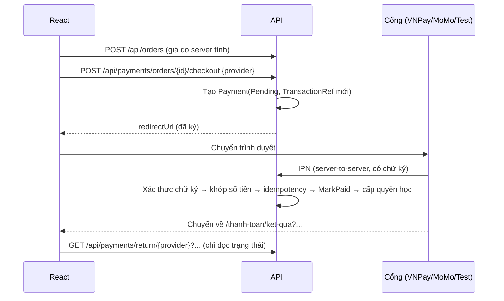

# 09 — Thanh toán & lưu trữ tệp (Giai đoạn 5)

## 1. Các phương thức thanh toán

| Phương thức | Khi nào bật | Thu tiền thật? |
| --- | --- | --- |
| **Kênh thanh toán thử nghiệm** | `Payments:TestGateway:Enabled = true` (bật sẵn trong `appsettings.Development.json`) | **Không**: tự động thành công |
| **VNPay** | Khi có `VnPay:TmnCode` và `VnPay:HashSecret` | Không với URL sandbox; có khi dùng URL production |
| **MoMo** | Khi có `MoMo:PartnerCode`, `AccessKey`, `SecretKey` | Không với endpoint `test-payment`; có khi dùng endpoint production |

Trang thanh toán chỉ hiện các phương thức đang bật (`GET /api/payments/methods`). Khi khách chọn kênh thử nghiệm hoặc cổng sandbox, trang hiện thông báo:

> **Hiện tại đang trong giai đoạn test kênh thanh toán, chưa thu tiền thật.**

Thông báo này cũng hiện trên trang kết quả thanh toán và trang chi tiết đơn hàng đã trả qua kênh test.

**Production phải tắt kênh thử nghiệm** (`Payments__TestGateway__Enabled=false`, mặc định trong `appsettings.json`). Khi tắt, endpoint `/api/payments/test/gateway` trả 404.

## 2. Luồng thanh toán



Kênh thử nghiệm đi **đúng các bước trên**. "Cổng" `/api/payments/test/gateway` (do API phục vụ) kiểm tra chữ ký của yêu cầu, tạo IPN có chữ ký HMAC-SHA256 rồi đưa vào cùng hàm xử lý IPN của VNPay/MoMo. Nhờ vậy khi chuyển sang cổng thật, luồng cấp quyền không phải thay đổi gì.

### Quy tắc bảo mật đã kiểm thử

| Quy tắc | Thực hiện |
| --- | --- |
| Không tin giá từ Frontend | Request tạo đơn không có trường giá; số tiền gửi sang cổng lấy từ `Order.TotalAmount` |
| Xác thực chữ ký | VNPay HMAC-SHA512 trên query đã sắp xếp và URL-encode; MoMo HMAC-SHA256 theo chuỗi `accessKey=…&amount=…`. So sánh trong thời gian cố định |
| Khớp số tiền | Số tiền IPN phải bằng `Payment.Amount` và `Order.TotalAmount`; lệch thì VNPay nhận `RspCode=04` |
| Idempotency | Giao dịch không còn ở trạng thái `Pending` thì bỏ qua (`02`); có unique index `(Provider, ProviderTransactionId)`; `MarkPaidAsync` chạy trong transaction và bỏ qua nếu đơn đã `Paid` |
| Không cấp quyền qua redirect | `/api/payments/return/*` chỉ trả trạng thái để hiển thị. Test kiểm chứng: return báo thành công, đúng chữ ký, đơn vẫn `Pending` |
| Thanh toán thất bại | Payment chuyển `Failed`, đơn vẫn `Pending` để khách thanh toán lại |
| Thanh toán hai lần | Giao dịch thứ hai được ghi `Success` kèm log cảnh báo để đối soát hoàn tiền; không cấp quyền lần nữa |
| Không lưu dữ liệu thẻ | Chỉ lưu mã giao dịch, mã ngân hàng, mã phản hồi và tham số callback (không có số thẻ) |
| Chống spam | Rate limit 60 yêu cầu/phút/IP cho checkout và IPN |

Mã phản hồi IPN VNPay: `00` thành công/đã ghi nhận thất bại, `01` không tìm thấy, `02` đã xử lý, `04` sai số tiền, `97` sai chữ ký, `99` lỗi khác. Tên trường giữ đúng `RspCode`/`Message`. MoMo IPN trả `204`, sai chữ ký trả `400`.

## 3. Cấu hình VNPay / MoMo sandbox

1. Đăng ký tài khoản sandbox:
   - VNPay: https://sandbox.vnpayment.vn/devreg — nhận `TmnCode` và `HashSecret`.
   - MoMo: https://developers.momo.vn — nhận `PartnerCode`, `AccessKey`, `SecretKey`.
2. Mở API ra Internet để cổng gọi được IPN về máy:
   ```powershell
   ngrok http 5080
   ```
3. Lưu khóa bằng User Secrets (không đưa vào mã nguồn):
   ```powershell
   cd backend\src\OnlineLearning.API
   dotnet user-secrets set "VnPay:TmnCode" "<TmnCode>"
   dotnet user-secrets set "VnPay:HashSecret" "<HashSecret>"
   dotnet user-secrets set "VnPay:IpnUrl" "https://<ngrok>.ngrok-free.app/api/payments/vnpay/ipn"
   dotnet user-secrets set "MoMo:PartnerCode" "<PartnerCode>"
   dotnet user-secrets set "MoMo:AccessKey" "<AccessKey>"
   dotnet user-secrets set "MoMo:SecretKey" "<SecretKey>"
   dotnet user-secrets set "MoMo:IpnUrl" "https://<ngrok>.ngrok-free.app/api/payments/momo/ipn"
   ```
   Với VNPay, URL IPN còn phải được khai báo trong trang quản trị merchant sandbox.
4. `Payments:ReturnUrl` mặc định là `http://localhost:5173/thanh-toan/ket-qua`.
5. Thẻ test VNPay (ngân hàng NCB): số `9704198526191432198`, chủ thẻ `NGUYEN VAN A`, ngày phát hành `07/15`, OTP `123456`.

Nếu chưa mở ngrok, cổng sandbox vẫn chuyển khách về trang kết quả nhưng đơn sẽ ở trạng thái "Đang chờ xác nhận", vì IPN không tới được máy. Đây là hành vi đúng: hệ thống không cấp quyền dựa trên redirect.

## 4. Lưu trữ tệp

| Loại | Giới hạn | Định dạng | Quyền tải lên | Truy cập |
| --- | --- | --- | --- | --- |
| Ảnh | 5 MB | JPG, PNG, WEBP, GIF | Mọi người dùng đã đăng nhập | Công khai |
| Video | 500 MB | MP4, WEBM, MOV, M4V | Giảng viên, Admin | **Riêng tư**: URL có chữ ký, chỉ cấp cho người có quyền xem bài |
| Tài liệu | 50 MB | PDF, ZIP, RAR, DOCX, XLSX, PPTX, TXT, MD | Giảng viên, Admin | **Riêng tư**: URL có chữ ký |

Mỗi tệp được kiểm tra phần mở rộng, dung lượng và **chữ ký tệp (magic bytes)**: một tệp `.png` có nội dung là script sẽ bị từ chối.

| Môi trường | Cách lưu |
| --- | --- |
| Có khóa Cloudinary | Ảnh lưu dạng `upload` (CDN công khai). Video/tài liệu lưu dạng `authenticated`; Backend tạo URL có chữ ký khi học viên đã ghi danh mở bài |
| Chưa có khóa (mặc định khi phát triển) | Ảnh lưu ở `wwwroot/uploads/images`. Video/tài liệu lưu ở `App_Data/storage` (không truy cập trực tiếp được), phát qua `/api/media/{id}?exp=…&sig=…` (HMAC, hết hạn sau 120 phút, hỗ trợ tua video) |

Cấu hình Cloudinary:

```powershell
dotnet user-secrets set "Cloudinary:CloudName" "<cloud name>"
dotnet user-secrets set "Cloudinary:ApiKey" "<api key>"
dotnet user-secrets set "Cloudinary:ApiSecret" "<api secret>"
```

URL `authenticated` có chữ ký của Cloudinary không đoán được nhưng không tự hết hạn. Muốn link có hạn dùng thì phải bật gói *Token-based authentication* của Cloudinary.

## 5. Giao diện

- **Thanh toán:** chọn phương thức, rồi "Đặt hàng và thanh toán" chuyển tới cổng. Đơn 0đ hoàn tất ngay.
- **Đơn hàng chờ thanh toán:** chọn phương thức và thanh toán lại trong thời gian còn hiệu lực.
- **`/thanh-toan/ket-qua`:** nhận biết cổng qua tham số, nhờ Backend xác thực chữ ký, rồi hỏi lại trạng thái đơn tối đa khoảng 15 giây nếu IPN tới chậm.
- **Soạn khóa học:** tải ảnh đại diện, tải video bài học (tự điền thời lượng khi dùng Cloudinary), tải tài liệu. Vẫn có thể dán URL như trước.
- **Hồ sơ:** tải ảnh đại diện.
- **Admin `/quan-tri/giao-dich`:** tra cứu và lọc giao dịch theo cổng và trạng thái.

## 6. Kiểm thử

`dotnet test`: 28 kịch bản, trong đó 9 kịch bản mới:
- Kênh test thành công qua IPN có chữ ký; gọi lại không cấp quyền lần hai; URL bị sửa bị từ chối.
- VNPay: chữ ký gửi đi đúng chuẩn; IPN sai chữ ký (97), sai số tiền (04), không tồn tại (01), hợp lệ (00), lặp (02); trang return không cấp quyền; thanh toán thất bại.
- MoMo: IPN giả chữ ký bị từ chối, IPN đúng chữ ký thì cấp quyền.
- Tải tệp: ảnh hợp lệ và dùng làm ảnh đại diện; tệp giả định dạng, đuôi cấm, học viên tải video đều bị chặn; video riêng tư chỉ phát qua URL có chữ ký, sửa chữ ký hoặc truy cập thẳng đều bị chặn.
