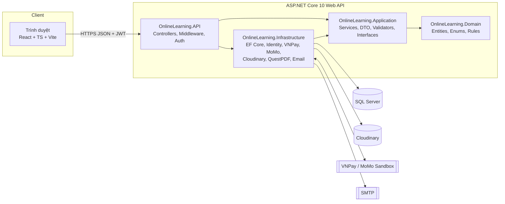

# 02 — Kiến trúc hệ thống

## 1. Tổng quan



## 2. Clean Architecture — quy tắc phụ thuộc

| Project | Phụ thuộc | Chứa |
| --- | --- | --- |
| `OnlineLearning.Domain` | (không, trừ `Microsoft.Extensions.Identity.Stores` cho `IdentityUser<Guid>`) | Entity, Enum, hằng số vai trò, quy tắc thuần |
| `OnlineLearning.Application` | Domain | Interface (`IAppDbContext`, `IPaymentGateway`, `IFileStorage`, `ICertificateGenerator`, `IEmailSender`, `ICurrentUser`), DTO, service nghiệp vụ, FluentValidation, `Result<T>` |
| `OnlineLearning.Infrastructure` | Application, Domain | `AppDbContext`, cấu hình Fluent API, Migrations, seed, Identity, JWT, VNPay/MoMo, Cloudinary, QuestPDF, SMTP |
| `OnlineLearning.API` | Application, Infrastructure | Controllers, middleware lỗi, CORS, rate limiting, Swagger, `Program.cs` |

Lõi nghiệp vụ (Domain + Application) không biết đến SQL Server, VNPay hay Cloudinary → đổi nhà cung cấp chỉ sửa Infrastructure.

## 3. Cấu trúc thư mục

```
(thư mục gốc repository)
├── setup/database/schema.sql     Script SQL Server tham chiếu (tương đương migration)
├── thesis/html/                  Tài liệu phân tích, thiết kế, hướng dẫn (các tệp 01–14 này)
├── docker/                       docker-compose.yml, .env.example
└── src/
    ├── backend/
    │   ├── OnlineLearning.sln
    │   └── src/
    │       ├── OnlineLearning.Domain/
    │       │   ├── Common/           BaseEntity, AuditableEntity
    │       │   ├── Constants/        Roles
    │       │   ├── Entities/         23 entity
    │       │   └── Enums/
    │       ├── OnlineLearning.Application/
    │       │   ├── Common/           Result, PagedResult, interfaces
    │       │   ├── Features/         Auth, Courses, Orders, Learning, Quizzes, Certificates, Admin…
    │       │   └── DependencyInjection.cs
    │       ├── OnlineLearning.Infrastructure/
    │       │   ├── Persistence/      AppDbContext, Configurations/, Migrations/, Seed/
    │       │   ├── Identity/         JwtTokenService
    │       │   ├── Payments/         VnPayGateway, MoMoGateway
    │       │   ├── Storage/          CloudinaryStorage
    │       │   ├── Certificates/     QuestPdfCertificateGenerator
    │       │   └── DependencyInjection.cs
    │       └── OnlineLearning.API/
    │           ├── Controllers/
    │           ├── Middleware/
    │           ├── Program.cs
    │           └── appsettings.json
    └── frontend/
        └── online-learning-client/
            └── src/
                ├── assets/  components/  contexts/  hooks/
                ├── layouts/ pages/       services/  types/
                └── main.tsx, App.tsx, index.css
```

## 4. Bảo mật — quyết định kiến trúc

| Mối nguy | Giải pháp |
| --- | --- |
| Lộ mật khẩu | ASP.NET Core Identity (PBKDF2 + salt), khóa tài khoản sau 5 lần sai |
| Đánh cắp token | Access token 15 phút trong bộ nhớ (không localStorage); refresh token HttpOnly + Secure + SameSite=Strict cookie, lưu **hash** trong DB, rotation + phát hiện tái sử dụng |
| Leo thang quyền | `[Authorize(Roles=…)]` + kiểm tra sở hữu tài nguyên trong service (Instructor chỉ sửa khóa của mình) |
| Sửa giá phía client | Backend tính lại giá từ DB; request chỉ chứa `courseIds` |
| Giả mạo callback | Xác thực HMAC-SHA512 (VNPay) / HMAC-SHA256 (MoMo), so khớp số tiền, chỉ IPN mới cấp quyền |
| Callback lặp | Unique index `(Provider, ProviderTransactionId)` + kiểm tra trạng thái trong transaction `Serializable`/rowversion |
| Truy cập video trả phí | Cloudinary `type=authenticated`, API cấp signed URL hết hạn sau 1 giờ khi có Enrollment |
| SQL Injection | Chỉ dùng EF Core LINQ (tham số hóa) |
| XSS | React escape mặc định; HTML bài viết lọc bằng DOMPurify; header CSP |
| Lộ bí mật | `appsettings.json` không chứa khóa thật; dùng User Secrets (dev) và biến môi trường (prod) |
| Brute force | `AddRateLimiter` cho `/auth/*` và `/payments/*` |

## 5. Quy ước API

- Tiền tố `/api`, REST, JSON camelCase, phiên bản qua route khi cần (`/api/v1`).
- Phản hồi lỗi chuẩn `ProblemDetails` (RFC 7807) + danh sách lỗi validation.
- Phân trang: `?page=1&pageSize=12` → `{ items, page, pageSize, totalCount, totalPages }`.
- Thời gian lưu UTC (`datetime2`), Frontend hiển thị múi giờ `Asia/Ho_Chi_Minh`.

## 6. Frontend

| Thư mục | Vai trò |
| --- | --- |
| `services/` | Axios instance + interceptor tự refresh token, mỗi module 1 file (`courseService.ts`…) |
| `contexts/` | `AuthContext` (user, roles, accessToken), `CartContext` |
| `hooks/` | `useAuth`, `useDebounce`, `usePagination`… |
| `layouts/` | `MainLayout`, `LearningLayout`, `DashboardLayout` (Student/Instructor/Admin) |
| `pages/` | Theo route, tiếng Việt slug: `/khoa-hoc/:slug`, `/gio-hang`, `/hoc/:courseId/:lessonId`… |
| `components/` | UI dùng chung: `CourseCard`, `Button`, `EmptyState`, `Skeleton`, `ProtectedRoute` |
| `types/` | Kiểu TS khớp DTO Backend |

Biểu đồ dashboard: Recharts. Thông báo: Sonner. HTML sanitize: DOMPurify.
